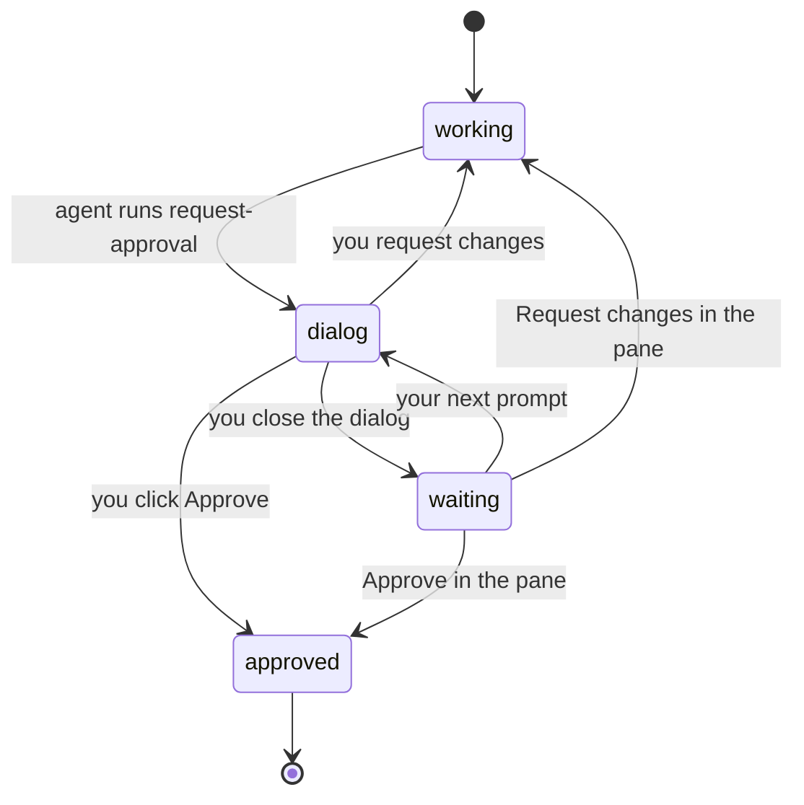
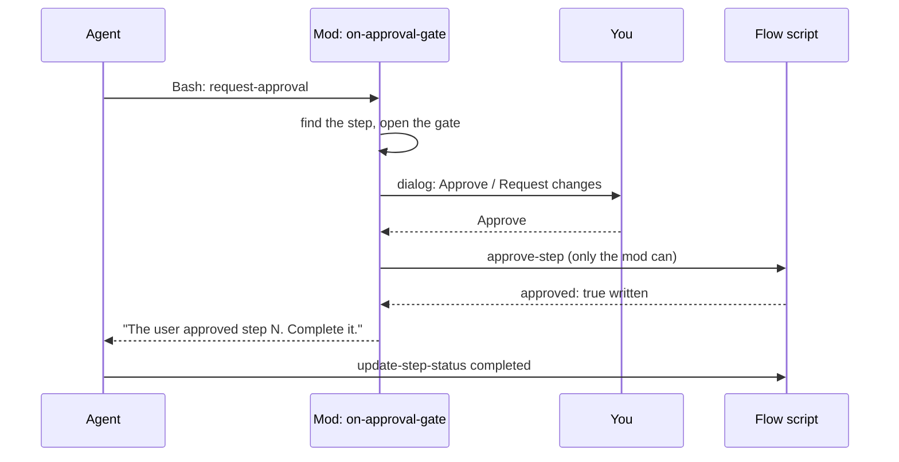

A step with `approvalRequired: true` cannot complete until you approve it. The **gate** is the set of rules that make this true. It does not trust the model: four separate checks must all hold.

## The gate, in states

| State | What it means | Stored as |
|---|---|---|
| `working` | The agent works. No gate is open. | No `gate:<id>` record |
| `dialog` | The agent asked. The dialog is on screen. | `gate:<id>` = `{ dir, stepId, dialog: true }` |
| `waiting` | You closed the dialog. The pane shows its own buttons. | `gate:<id>` = `{ dir, stepId }` |
| `approved` | The step has `approved: true` and the gate is gone. | `approved` in `flow.json` |

The gate is in the mod store, so a restart or a reload does not lose it.

## The path of one approval

- `request-approval` is not run by the script. The mod answers the call itself, and the call waits for your click. The answer is the text the agent reads.
- **Approve** makes the mod run `approve-step`. The script writes `approved: true`. No other command writes it.
- **Request changes** returns your text to the agent. It changes the step, then calls `request-approval` again.
- If you close the dialog, nothing is decided. The gate stays open. Your next prompt opens the dialog again. Only one dialog can be open for a session at a time.
- Your answer is logged in the flow log by the mod, before `approved` is written. If the log fails, the step is not approved and the agent is told to stop and tell you.

## The four checks

| # | Check | Where | Stops |
|---|---|---|---|
| 1 | The agent has no approve command. `approve-step` is refused for it. | `checkCall` in `flow-manager/script.ts` | The agent approving itself |
| 2 | A step with `approvalRequired` cannot be set `completed` until `approved` is true. | `update_step_status` in `flow_manager.py` | Skipping the gate, even by another path |
| 3 | While a gate is open, only research tools pass. | `on-pending-checkpoint` | Building on a step that is not approved |
| 4 | Hand edits of `flow.json`, `log.json`, memory and findings are refused. | `on-approval-gate` | Writing `approved: true` by hand |

Check 2 lives in the script, not in the mod. If the mod is not loaded, the script still refuses to complete an unapproved step.

## While the gate is open

`on-pending-checkpoint` listens to every `tool.call`. While a gate is open it lets only these through:

- `Read`, `Glob`, `Grep`, `LS`, `WebFetch`, `WebSearch`;
- `Agent` and `Task` (subagents, for research);
- any MCP tool (names that start with `mcp__`);
- Bash commands of the flow script. The script gate then decides: while a dialog is on screen, the commands that change the flow (`update-step-status`, `update-current-state`, `update-active-substep`, `update-flow-status`) are refused.

Everything else (Write, Edit, other Bash commands, todo tools) is refused with a text that says an approval is needed. A toast tells you why Claude cannot go on. A subagent's own calls follow the same rule.

## Where you can answer

You can answer in the dialog or in the pane (the buttons of the gate card). Both paths check the world again at the moment of the click: the step must still be the one that waits, and the agent must have asked. A pane click while a dialog is open is refused ("Answer the dialog that is open").

Typing "approved" in chat does nothing. Only a click counts.

## Source

`hooks/on-approval-gate/`, `hooks/infra/approval-gate/approval-gate.ts` (`askGate`, `reopenPanel`, `isHandEdit`), `hooks/on-pending-checkpoint/`, `scripts/flow_manager.py` (`approve_step`, `update_step_status`).
