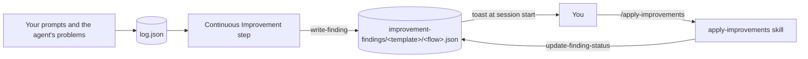

Every flow learns something about its template. Improvement findings keep that lesson after the flow ends.



## Step 1: the log collects the evidence

During a flow the log gets two kinds of evidence:

- **Interactions.** The mod logs each of your prompts and each of your answers in an approval dialog. A small model (Haiku) writes the reason, the answer and a flag `forImprovementStep`, with the improvement in `potentialImprovement`, when your request points to a fix of the flow itself.
- **Problems.** The step-executor writes `problems`, `decisions` and notes for each step, with the log command of the script.

## Step 2: the Continuous Improvement step

The framework adds this step to every flow, before Complete Flow. It needs no approval and never blocks the flow. It reads the log and looks for patterns: repeated corrections, many iterations, problems and workarounds, missing checks, gaps in the docs. It starts with the flagged interactions.

It saves the top 3 to 5 findings with `write-finding`. It changes no template and no file.

## Step 3: where findings live

One file for each flow, in a folder for each template:

```
~/.claude/zeremai/improvement-findings/<templateId>/<flowId>.json
```

`<templateId>` is the id of the template. A template installed before ids existed uses its name. The file holds a list of findings:

| Field | Meaning |
|---|---|
| `id`, `flowId`, `flowName`, `template`, `createdAt` | Identity |
| `category`, `title` | What kind of problem, in a few words |
| `what`, `why`, `impact` | The finding, the reason, the effect |
| `scope` | The files or steps it touches |
| `status` | `open`, then `applied`, `rejected` or `deferred` |
| `resolution` | When it was resolved, with notes and the files changed |

A write takes the lock of that file, as every script write does. See [Memory and safe writes](/design/memory). The agent cannot edit these files by hand: `on-approval-gate` refuses it.

## Step 4: the nudge

When a session starts, the mod asks the script for the open findings (`list-findings`) and shows one toast with the count: "2 improvement findings wait. Run /zeremai:apply-improvements to review them." For zero findings it shows nothing.

## Step 5: applying findings

The `apply-improvements` skill is the only thing that changes a finding after it is saved. For each finding it proposes the change, waits for your decision (approve, reject or defer), and for an approved one it edits the real files in one change. Then it calls `update-finding-status`, which sets the status and a `resolution` with the time, notes and files modified.

`update-finding-status` finds the file by the flow id, which is unique everywhere, so it needs no template folder.

A template you do not own (installed from a marketplace) is not edited. The skill says so and stops. The right place for that change is the marketplace repository.

## Source

`framework-steps/continuous-improvement/`, `scripts/flow_manager.py` (`write_finding`, `list_findings`, `update_finding_status`), `skills/apply-improvements/SKILL.md`, `hooks/on-flow-tools/on-flow-tools.ts` (`nudgeFindings`).
