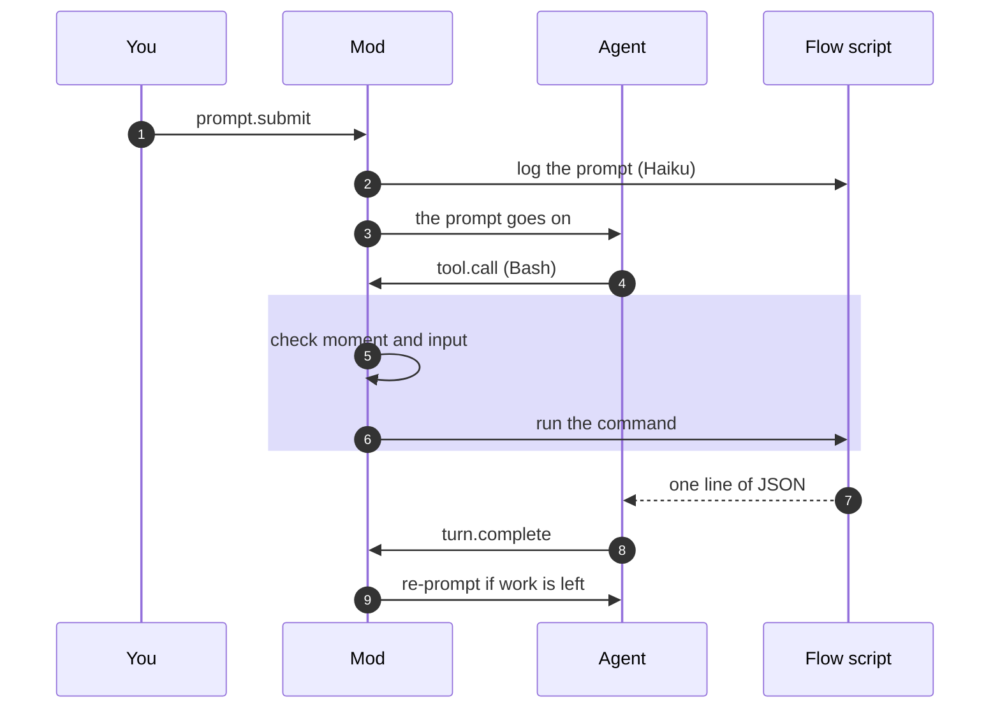

The mod is a set of hooks. Claude Code calls a hook when something happens. Each rule listens to the events it needs.

## The events the mod uses

| Event | When it fires | Rules that listen |
|---|---|---|
| `session.start` | A session starts, and again after every reload of the mod | `on-flow-tools`: draws the step line, shows a toast when findings wait, registers `/zeremai` |
| `prompt.submit` | You send a prompt (or the plugin sends one) | `on-user-prompt`: logs your prompt, reopens a closed approval dialog |
| `tool.call` | The agent is about to run a tool | `on-flow-tools`, `on-approval-gate`, `on-pending-checkpoint`, `on-todo-tool` |
| `turn.complete` | The agent ends a turn | `on-agent-stopping`: sends a re-prompt if the flow has work left |
| `command.run`, `ui.*` | `/zeremai` runs, the pane draws or you press a button | `on-flow-pane` |
| a timer | Every 5 seconds while the pane is open | `on-flow-pane`: refreshes the pane |

## One turn, as the mod sees it

## How hooks combine

Every hook receives the event and a function `next`. The hook can:

- call `next(e)` to pass the event on, and use the answer;
- return `{ deny: text }` for a tool call, so the call does not run and the agent reads `text`;
- return `{ drop: text }` for a prompt, so it is not sent and you read `text`.

Several rules listen to `tool.call`. A call must pass all of them. One deny is enough to stop it.

A prompt the plugin sends itself (a re-prompt, or the answer of an approval dialog) has the origin `plugin`. `on-user-prompt` ignores it: it is not logged, and it does not start the re-prompt count again.

## What a reload keeps and loses

Claude Code loads the mod again when its files change. A load is fresh: `register` runs again and `session.start` fires again.

| Kept | Lost |
|---|---|
| The mod store (`session:<id>`, `gate:<id>`) | Module variables: the re-prompt count, toast timers, the one-dialog-at-a-time set |
| Files in `~/.claude/zeremai/` | Pane state (which tab is open) |

The kept state decides what matters. The bound flow and an open approval gate are in the store, so a reload does not lose them. A count or a timer can start again without harm.

A resumed Claude Code session has a new session id, and so a new list of bound flows. You resume the flow from the **Continue** tab, and the pane binds it again.

## Faults

A hook that throws is skipped by Claude Code, and the event goes on to the next rule. Only `on-approval-gate` has its own fault handler: a fault in its hand-edit check refuses the call, and a fault elsewhere in the approval path approves nothing. The gate fails closed, not open.

When a rule blocks or re-prompts the agent, it shows a toast, so you know why Claude changed course. The same text shows at most once in 30 seconds.

## Source

`hooks/register.ts` lists the rules. Each `hooks/on-*/on-*.ts` file registers one rule.
